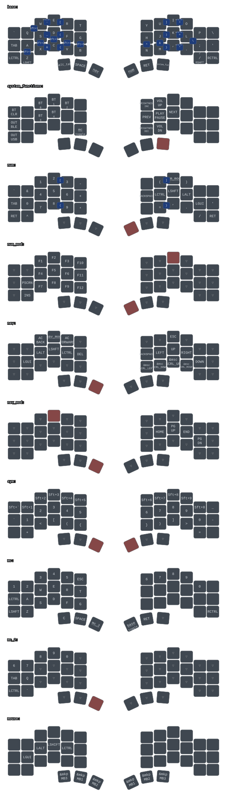

# my map (2)

For the Toucan 2, with a keymap that is largely the same as [my Kyria](https://github.com/akioweh/zmk-config).



## Building

This repo is designed for local compilation.

Core reqs:

- Git, CMake, Ninja
- [Zephyr SDK 0.17.0](https://zmk.dev/docs/development/local-toolchain/setup/native)
- [`just`](https://github.com/casey/just)
- [`uv`](https://docs.astral.sh/uv/getting-started/installation/)

`just` provides shortcuts for common commands; run (from repo root) to see list of available recipes:

```sh
just
```

### Outputs

- `.build/build/left/zephyr/zmk.uf2`
- `.build/build/right/zephyr/zmk.uf2`

## Key thingies

- [`config/toucan.json`](config/toucan.json): layout data for [Keymap Editor](https://nickcoutsos.github.io/keymap-editor/)
- [`hardware/drivers/iqs5xx/`](hardware/drivers/iqs5xx/README.md): native trackpad driver and build options
- [`west.yml`](west.yml) pins [my fork of ZMK](https://github.com/akioweh/zmk/tree/feat/ptp-core).
  It contains changes to enable multitouch precision touchpad support.
  There is also a `zmk,ptp-touch` input bridge indicating when the trackpad is in use.
  (This is used to auto-activate the mouse layer.)

## License

Original contributions are [MIT](LICENSE).

This repo also contains some upstream material, all MIT:

- Toucan shield definitions and Keymap Editor layout: [beekeeb](https://github.com/beekeeb/zmk-keyboard-toucan2), with its [original license](hardware/boards/shields/toucan/LICENSE).
- Keymap SVG styling: [keymap-drawer](https://github.com/caksoylar/keymap-drawer), with its [original license](keymap-drawer/LICENSE).
